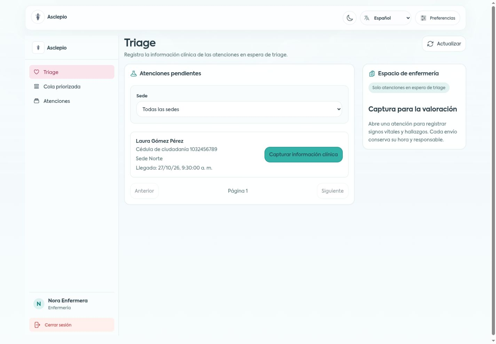
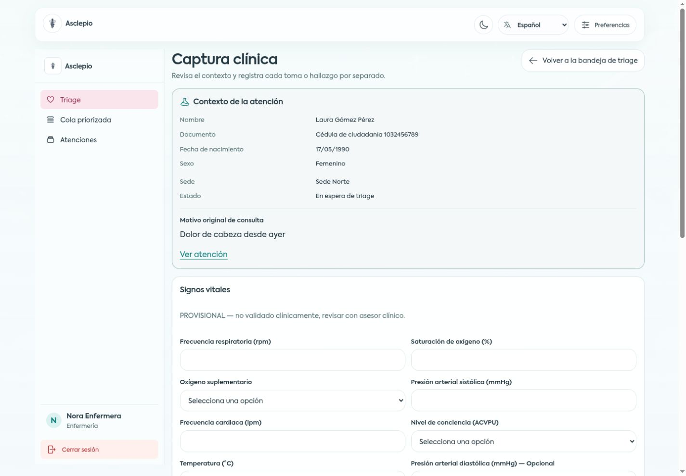

# F-03-web — Verificación de enfermería y captura clínica

Fecha: 2026-10-28, America/Bogota. Plan completo aprobado por el usuario mediante «PLEASE IMPLEMENT THIS PLAN» antes del código. Referencia web inicial `c94aae5727da8c0e23da0fd78856aee083957963`; API de referencia `2f2672bbe7c2cf5c852e7295a90dd225389d27bc`, contrato **0.4.0**. Trabajo en `codex/clinical-capture`, con commits convencionales por bloque y publicación autorizada en `main` de ASCLEPIO-SWNT/asclepio-web.

## Resultado y alcance

- `/triage`: bandeja NURSE de atenciones WAITING_TRIAGE, filtro por sede y página50 en URL, actualización manual, estados vacíos/de error.
- `/triage/:id`: contexto y motivo original literales, formularios independientes de signos vitales y síntomas/hallazgos/notas, historial con unidades, responsable y hora del servidor en Bogotá.
- `/atenciones/:id`: consulta clínica para NURSE/PHYSICIAN; enlace de captura sólo para NURSE en WAITING_TRIAGE. RECEPTION/ADMIN no solicitan el endpoint clínico.
- Cinco idiomas, preferencias y guía estática adaptados. Los borradores permanecen en memoria y no se trasladan entre atenciones.
- Sin cambios en API, móvil, contrato, migraciones ni dependencias. Sugerencia IA, decisión, cola y reportes permanecen en sus slices pendientes.

## Comprobaciones automatizadas

| Comprobación | Resultado |
| --- | --- |
| `./init.sh` inicial | VERDE, FAIL0/WARN0 |
| `./init.sh` final | VERDE, FAIL0/WARN0: lint, typecheck y suite completa |
| `npm test -- --reporter=json` | **399/399**, 0 fallidas/pendientes, 30 archivos |
| `npm run api:types` | Sin diff en `schema.d.ts` ni `clinicalContract.generated.ts`; extracción reproducible desde 0.4.0 |
| `npm run i18n:check` | Claves y parámetros equivalentes en es/en/pt/fr/de |
| `npm run build` | Correcto; JS679.62kB, gzip199.60kB, aviso de chunk >500kB no bloqueante |
| `git diff --check` | Limpio |

El reviewer ejecutó init, build, generación y las34 pruebas de rutas de manera independiente. Los logs y el JSON con399 resultados se conservan fuera del repositorio en `local-analysis/f03-verification/` y `local-analysis/verification/`; no se incluyen credenciales, trazas de pacientes reales ni servidores sintéticos en el producto.

## Trazabilidad R1–R24

Las pruebas citadas comienzan por el prefijo exacto `R<n>:`. Rutas = `src/app/router/f03Routes.test.tsx`; Esquemas = `src/features/triage/clinicalSchemas.test.ts`; Hooks = `src/features/triage/hooks/clinicalCaptureHooks.test.tsx`; Formularios/Historial = pruebas homónimas bajo `src/features/triage/components/`; Voz = `src/shared/preferences/VoiceGuide.test.tsx`.

| Requisito | Evidencia principal |
| --- | --- |
| R1 | Rutas: tres roles prohibidos, sin peticiones clínicas |
| R2 | Rutas: WAITING_TRIAGE fijo, sede/offset, reinicio de página y offset inválido |
| R3 | Rutas:50 elementos, retorno con filtros, NN, refresco manual y ausencia de polling/focus/reconnect |
| R4 | Rutas/Historial: carga, vacío, error, reintento y ocultación de datos obsoletos |
| R5 | Rutas: A→B descarta borrador anterior mediante identidad de atención |
| R6 | Rutas: consulta para NURSE/PHYSICIAN, sin GET clínico para RECEPTION/ADMIN |
| R7 | Esquemas/Formularios:7 requeridos,2 opcionales,9 etiquetas/unidades y selecciones clínicas vacías |
| R8 | Esquemas/Formularios: límites inclusivos, enteros, precisión decimal, ACVPU, oxígeno explícito, coherencia de presión y foco |
| R9 | Esquemas/Hooks: opcionales vacíos omitidos, oxígeno false y DTO exacto |
| R10 | Formularios: un envío, formulario pendiente deshabilitado y sin duplicados |
| R11 | Esquemas/Hooks/Formularios:1–20 elementos, tipos publicados, trim1–500, añadir/quitar filas |
| R12 | Esquemas: COMPLAINT_NOTE sin mutación del motivo original |
| R13 | Formularios/Rutas: guardados independientes, historial acumulado y borrador ajeno retenido durante refresco demorado |
| R14 | Historial: todos los valores del servidor, orden contractual, unidades, responsable y Bogotá |
| R15 | Formularios/Rutas: ambos envíos bloqueados en REGISTERED/TRIAGED/IN_CARE/CLOSED/CANCELLED |
| R16 | Formularios:400/422 indexados por campo, mensajes localizados y foco tras habilitar controles |
| R17 | Hooks/Formularios/Rutas:409 sin retry, invalidaciones, borradores retenidos y bloqueo incluso al fallar la reevaluación |
| R18 | Hooks/Formularios: red/400/401/403/404/422, sin retries de escritura y borradores conservados |
| R19 | Formularios/Rutas:403/404 inaccesibles,401 cierra sesión, contexto primero y GET clínico condicionado al permiso |
| R20 | Esquemas/Hooks/Rutas: caché por atención, defaults sin metadatos legales, sin datos clínicos en storage/URL/voz |
| R21 | Rutas: jerarquía, navegación y acciones visibles; geometría comparada con fuente legacy y capturas reales |
| R22 | Rutas: etiquetas y validaciones ARIA de ambos formularios en cinco idiomas, sin envíos inválidos |
| R23 | Formularios/Rutas: cambio de idioma/tema conserva ambos borradores y validaciones |
| R24 | Voz/Rutas: A→B→A desde activo y fallo, callbacks cancelados, cambios de idioma/texto y guía sin datos de paciente |

## QA funcional con navegador

Se usó una API **sintética local** en127.0.0.1:3002 y build de revisión en127.0.0.1:5176, con datos ficticios de las fixtures y endpoints contractuales. No es una ejecución de NestJS/Prisma/PostgreSQL. El servidor y sus controles de error/reset viven en `local-analysis/`, fuera del repositorio web.

- Login NURSE, filtro Sede Norte, entrada a captura y enlace de regreso conservando `siteId`/`offset`.
- Captura18rpm,98%, oxígenoNo, sistólica120, FC87, ACVPU A,36.7°C y opcionales vacíos. El POST exitoso limpia sólo signos vitales; conserva la nota del otro formulario.
- Guardado de COMPLAINT_NOTE conserva la nueva FC91 del formulario de signos. Historial con unidades, opcionales «—», Nora Enfermera y hora Bogotá. El motivo original y la línea de tiempo se conservan.
-422 inyectado: aviso comprensible, `aria-invalid=true` y foco en `vital-heartRate`; ambos borradores conservados. Reintento explícito201 correcto.
- Cancelación concurrente y posterior POST409: estado Cancelada, ambos formularios completamente bloqueados y borradores visibles; no se reintenta la escritura.
- Detalle con NURSE y PHYSICIAN: historial visible; medicina tiene0 formularios y0 enlaces de captura. La matriz completa y la ausencia de GET para otros roles están verificadas en red sintética automatizada.
- Cambio en→pt→fr→de→es conserva FC, oxígenofalse y nota literal; sin claves ausentes. Repetido en375px con ambos borradores conservados y sin overflow.
- Guía: el sistema de síntesis no está disponible en este navegador y se informa sin bloquear la pantalla. Detalle A→lista B→detalle A recupera «Escuchar guía». Reproducción/pausa/callbacks se verifican con el doble de síntesis en Vitest.

## Comparación visual y accesibilidad

Se comparó la implementación con `develop` del frontend anterior: `nurse-dashboard.view.tsx` y `role-dashboard-shell.tsx` (composición de tarjetas, filas, encabezado y panel auxiliar), `vital-signs.form.tsx` (inputs numéricos, espaciado y1/2 columnas) y el marco de `dashboard.page.tsx` ya adaptado en UI-01. Se mantienen Axiforma, marca, fondos, turquesa, radios y navegación existentes; el contenido y los campos corresponden a la nueva arquitectura. No se afirma una comparación píxel a píxel del dashboard autenticado legacy, cuyo backend anterior no está conectado.

| Ancho CSS | clientWidth/scrollWidth en bandeja y captura | Columnas de signos |
| --- | --- | --- |
|375 |360/360 |1 |
|768 |753/753 |2 |
|1024 |1009/1009 |2 |
|1440 |1425/1425 |2 |

La diferencia15px es la barra vertical. Capturas estables de bandeja/captura en los cuatro anchos en `docs/ui-evidence/f03-*`. Se descartó una captura fullPage defectuosa de la herramienta y se sustituyó por captura del viewport real; no se reprodujo un fallo de distribución en la página.

- Claro y oscuro revisados en bandeja/captura a los cuatro anchos, sin desbordamiento. Alto contraste y fuente OpenDyslexic aplicados sin perder FC91. Axiforma/OpenDyslexic presentes en los estilos computados; la carga local de fuentes ya está verificada en UI-01. Evidencia adicional `f03-capture-dark-1440.jpg` y `f03-tray-dark-1440.jpg`.
- Texto200%: raíz32px;375 y1440 conservan clientWidth=scrollWidth y el borrador. Captura `f03-capture-200-contrast.jpg`.
- Teclado: foco de validaciones y selección explícita de controles; Tab real recorre frecuencia respiratoria→saturación→oxígeno en el orden visible. Botones/enlaces nativos, navegación plegable y etiquetas accesibles. Regresiones ARIA y foco en las pruebas de ambos forms.
- El atajo de zoom del navegador fue intentado sin cambio efectivo de escala en IAB; **zoom nativo200% queda como comprobación manual pendiente de plataforma**. La ampliación200% del texto y el reflujo sí se ejecutaron.
- La regla existente `prefers-reduced-motion: reduce` elimina animaciones/transiciones y scroll suave, también en estas pantallas. **La emulación nativa de esa preferencia queda pendiente**, al no exponerla el navegador automatizable.

## Límites y siguiente bloque

Falta `.env` del backend local y la preparación de su esquema/cuentas de prueba. Queda pendiente la integración web→API real→PostgreSQL; no se ejecutaron migraciones ni se modificó la configuración del equipo. Los rangos siguen marcados provisionales según contrato, sin reglas clínicas añadidas.

Tras esta entrega, F-04-web requiere el contrato de sugerencia publicado y F-05-web el de decisión. Cola y reportes continúan pendientes; los accesos actuales mantienen esa indicación.

Revisión independiente **APROBADA**, C1–C8 completos y R1–R24 cubiertos, sin defectos bloqueantes. El veredicto y el cierre de F-03-web se registran en `progress/history.md`; los informes completos se archivan localmente fuera del repositorio conforme al harness.
